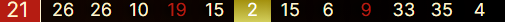
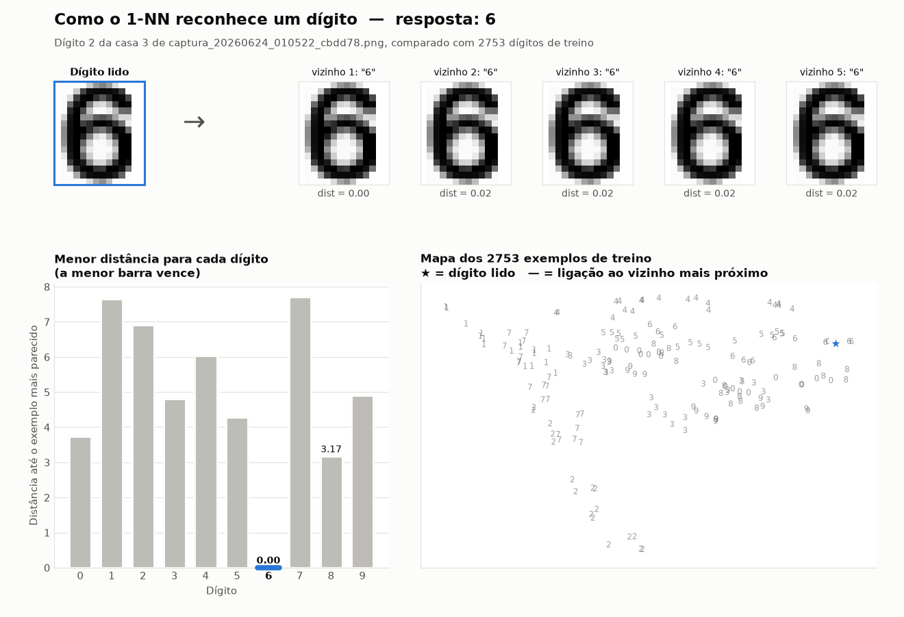
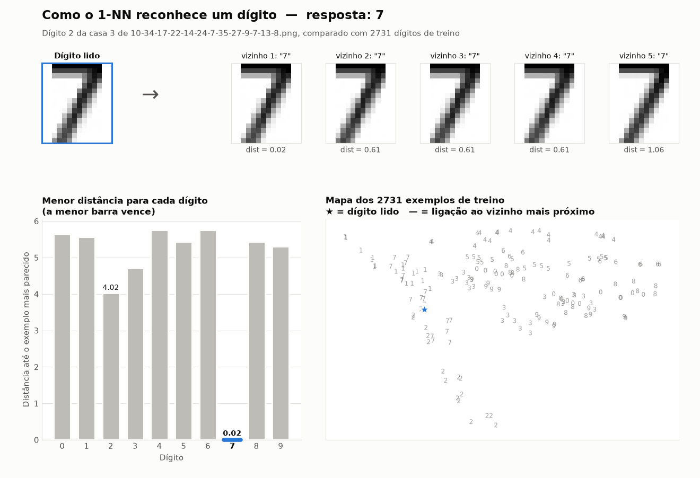
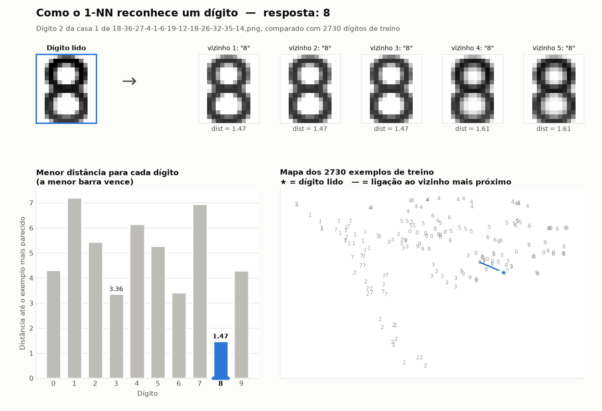
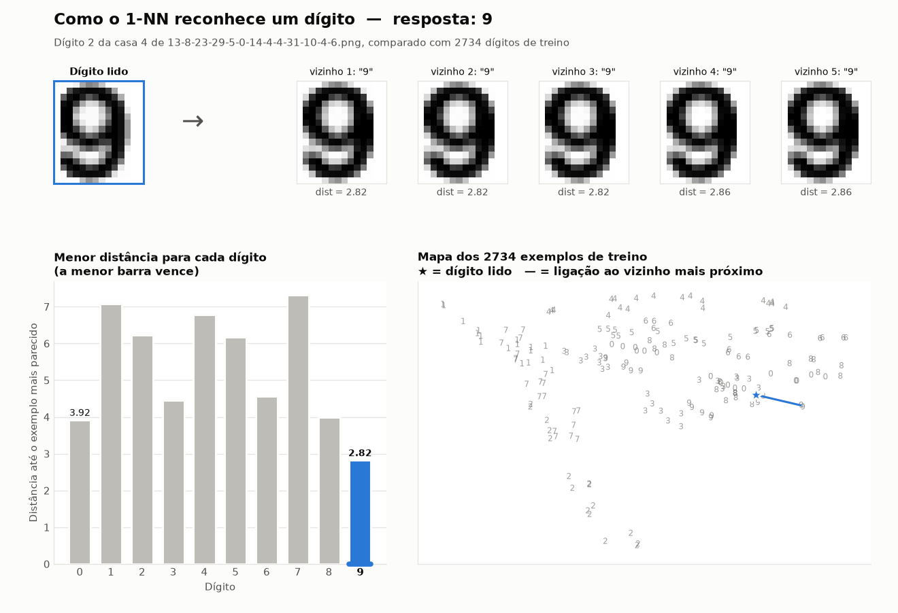

# Leitor de Tela — Reconhecedor de Números de Roleta

Lê uma captura da faixa de resultados da roleta (13 números em linha) e devolve a lista de números.



```
python reconhecer.py novas/captura_20260624_010522_cbdd78.png
[21, 26, 26, 10, 19, 15, 2, 15, 6, 9, 33, 35, 4]
```

---

## 1. Instalação

Requer Python 3.10+.

```bash
python -m venv venv
venv\Scripts\pip install -r requirements.txt
```

Em todos os comandos abaixo, use o Python do `venv`: ative antes com `venv\Scripts\activate` ou chame `venv\Scripts\python.exe` direto.

---

## 2. Capturar a tela

```bash
python tools/capturar_tela.py
```

Salva um recorte de **505 × 22 px** da tela em `novas/captura_<data>_<hora>_<id>.png`.

A região capturada está fixa em [tools/capturar_tela.py](tools/capturar_tela.py):

```python
REGIAO = {"top": 120, "left": 1390, "width": 505, "height": 22}
```

Se a janela do jogo mudar de lugar, descubra as novas coordenadas com:

```bash
python tools/mouse.py
```

Esse script mostra a posição do mouse em tempo real. Clique no **canto superior esquerdo** da faixa de números e copie o `X` para `left` e o `Y` para `top`. Feche com `Ctrl+C`.

> Mantenha o mesmo zoom do navegador e a mesma escala do Windows. Se o tamanho da faixa mudar, o reconhecimento pode falhar.

---

## 3. Reconhecer os números

**Uma imagem:**
```bash
python reconhecer.py novas/captura_xxx.png
```

**Todas as imagens de uma pasta:**
```bash
python reconhecer.py novas
```

**Com detalhes de confiança:**
```bash
python reconhecer.py novas/captura_xxx.png --debug
```
```
  Casa  1:  21   dist=  0.00
  Casa  2:  26   dist=  0.00
  ...
  Casa  9:   6   dist=  5.40  <-- DUVIDOSO
```

- `dist` mostra o quanto o dígito lido difere do exemplo mais parecido do treino. Perto de 0 significa leitura certa.
- `DUVIDOSO` aparece quando `dist > 3,5`: confira essa casa na imagem.
- `-1` indica que a casa não pôde ser lida (região errada, imagem cortada etc.).

**Dentro de outro script Python:**
```python
from reconhecer import Modelo, reconhecer_imagem

modelo = Modelo.do_treino()          # monte uma vez e reutilize
numeros = reconhecer_imagem("novas/captura_xxx.png", modelo)
```

---

## 4. Dados de treino

A pasta `treino/` contém imagens cujo **nome é o gabarito**: os 13 números, da esquerda para a direita, separados por traço.

```
treino/26-16-17-25-18-26-21-26-25-0-12-15-31.png
```

O modelo é montado a partir dessa pasta **toda vez** que o programa roda. Não há etapa de indexação.

**Quando adicionar uma imagem ao treino:** só quando aparecer uma leitura errada ou `DUVIDOSO`. Renomeie a captura com os números corretos e mova para `treino/`. Os dados atuais já cobrem todos os dígitos.

### Medir a precisão

```bash
python reconhecer_dados_treino.py             # mostra só os erros
python reconhecer_dados_treino.py --detalhes  # mostra todas as imagens
```

Cada imagem de `treino/` é reconhecida usando apenas as **outras** imagens. Isso simula imagens novas. Também serve para achar imagens **mal renomeadas**: se uma imagem aparecer com erro, confira primeiro se o nome do arquivo está certo.

Resultado atual: **125/125 imagens, 1625/1625 casas corretas (100%)**.

---

## 5. Como funciona

1. **Casas:** a imagem é dividida nas 13 posições fixas. A 1ª é a caixa grande, com fonte maior; as demais ficam a cada ~38,33 px.
2. **Fundo:** em cada casa, a cor do fundo é estimada linha a linha pela margem esquerda, onde nunca há dígito. Os pixels que contrastam com esse fundo são o número. Funciona com texto branco, vermelho ou verde, sobre fundo escuro, dourado ou colorido.
3. **Dígitos:** cada dígito é recortado separadamente. Dígitos encostados (ex.: `30`) são divididos na coluna com menos tinta.
4. **Classificação:** cada dígito (0–9) é comparado com os ~2.500 dígitos extraídos do treino, e vence o mais parecido (vizinho mais próximo).

Os parâmetros ficam no topo de [reconhecer.py](reconhecer.py) (`PASSO_CASA`, `LIMIAR`, `DIST_ALERTA`…).

### Algoritmos usados — é IA?

Não é IA no sentido de rede neural ou ChatGPT. São duas técnicas clássicas e simples:

**Visão computacional clássica (OpenCV + NumPy)**, para separar os dígitos (passos 1 a 3):
- recorte por posição fixa;
- diferença de cor de cada pixel em relação ao fundo (distância entre cores RGB);
- detecção dos "borrões" de pixels conectados (`cv2.connectedComponentsWithStats`), em que cada borrão é um dígito.

Nessa parte não há aprendizado, só regras fixas.

**Vizinho mais próximo (1-NN, *k-nearest neighbors* com k=1)**, para dizer qual dígito é (passo 4):
- cada dígito recortado é reduzido a uma grade de 16×14 = 224 valores (intensidade de cada pixel);
- esses valores são comparados com os ~2.500 dígitos do treino, cuja resposta já se sabe pelo nome do arquivo;
- o exemplo mais parecido (menor distância euclidiana) define a resposta. É esse valor que aparece como `dist` no `--debug`.



- **Topo:** o dígito lido e os 5 exemplos de treino mais parecidos. Todos são "6", com distância quase zero.
- **Esquerda:** a menor distância até cada dígito de 0 a 9. Vence a menor, aqui o 6 (0,00); o segundo colocado é o 8 (3,17), bem mais longe.
- **Direita:** os exemplos de treino num mapa 2D, cada um desenhado como o próprio dígito. Dígitos parecidos ficam perto, e a linha azul liga o dígito lido (★) ao vizinho mais próximo. O mapa é uma projeção simplificada (PCA): na comparação real, com os 224 valores, os grupos ficam bem mais separados do que aparentam aqui.

O que importa é a **folga** entre o 1º e o 2º colocado na barra da esquerda: quanto maior, mais seguro o resultado.

#### Mais exemplos

Nos três exemplos abaixo, a imagem de origem está em `treino/`, mas **foi tirada do modelo** antes da comparação. Assim o dígito é tratado como se fosse novo, e não se compara com ele mesmo.

**Fundo dourado (casa destacada).** O "7" de `17` em `10-34-17-22-…`. Mesmo com o fundo em degradê, a remoção do fundo deixa o dígito limpo. Ele bate com outro "7" a 0,02, enquanto o 2º colocado ("2") fica a 4,02.



**Casa grande (1ª posição, fonte maior).** O "8" de `18` em `18-36-27-…`. A fonte é maior, mas todo dígito é redimensionado para 16×14 antes da comparação, então ele também bate com os "8" das casas pequenas. Vence com 1,47; o 2º ("3") fica a 3,36.



**Caso mais difícil do treino.** O "9" de `29` em `13-8-23-29-…`. Entre todos os dígitos do treino, é o que tem a menor folga: vence com 2,82 contra 3,92 do "0". Mesmo assim acerta, e a distância continua abaixo do limite de alerta (`DIST_ALERTA = 3,5`).



Para gerar os gráficos de novo (ou com outro dígito):

```bash
python tools/grafico_knn.py                       # exemplo padrão → docs/knn.png
python tools/grafico_knn.py --imagem novas/captura_xxx.png --casa 5 --digito 1 --saida docs/meu_exemplo.png
```

`--casa` vai de 1 a 13 e `--digito` é 1 ou 2 (o 1º ou o 2º dígito da casa). Se a imagem estiver em `treino/`, ela é tirada do modelo automaticamente.

Tecnicamente, o 1-NN conta como *machine learning*, porque aprende com exemplos rotulados. Mas é o algoritmo mais simples que existe: não tem etapa de treinamento, pesos nem rede neural. O "modelo" é só a lista de exemplos guardada na memória.

**Por que não precisa de IA mais pesada:** as imagens são capturas de tela, com fonte, tamanho e posição sempre iguais. O mesmo dígito gera praticamente os mesmos pixels toda vez, então a busca pelo mais parecido acerta 100%. Uma rede neural só valeria a pena com variação de verdade, como fotos de celular, ângulos ou fontes diferentes. Aqui ela seria mais lenta e mais difícil de manter, sem acertar mais.

---

## 6. Problemas comuns

| Sintoma | Causa provável | Solução |
|---|---|---|
| Muitos `-1` ou `DUVIDOSO` | Região de captura errada | Reajuste `REGIAO` com `tools/mouse.py` |
| Números totalmente errados | Zoom ou escala da tela mudou | Volte o zoom anterior ou refaça o treino na escala nova |
| Uma casa errada de vez em quando | Caso raro sem exemplo no treino | Renomeie a captura com os valores certos e mova para `treino/` |
| `Nenhum dígito de treino` | Pasta `treino/` vazia ou nomes inválidos | Nomes devem ter exatamente 13 números de 0 a 36 |

---

## Estrutura

```
leitor_tela/
├── reconhecer.py               # reconhecedor (CLI e funções)
├── reconhecer_dados_treino.py  # avaliação de precisão
├── requirements.txt
├── tools/
│   ├── capturar_tela.py        # tira a captura da faixa de números
│   ├── mouse.py                # mostra coordenadas do mouse
│   └── grafico_knn.py          # gera o gráfico do 1-NN (docs/knn.png)
├── docs/                       # imagens do README
├── treino/                     # imagens rotuladas pelo nome
└── novas/                      # capturas a reconhecer
```
